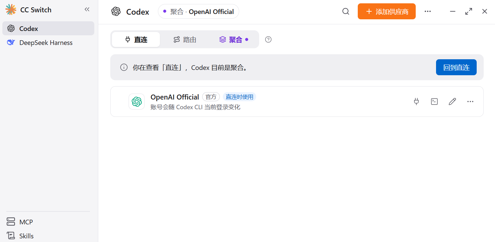
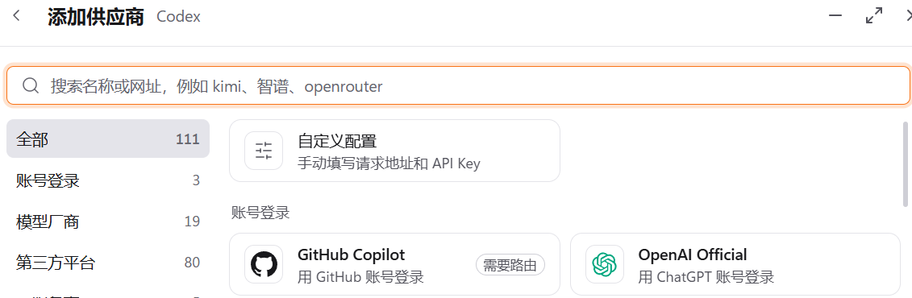
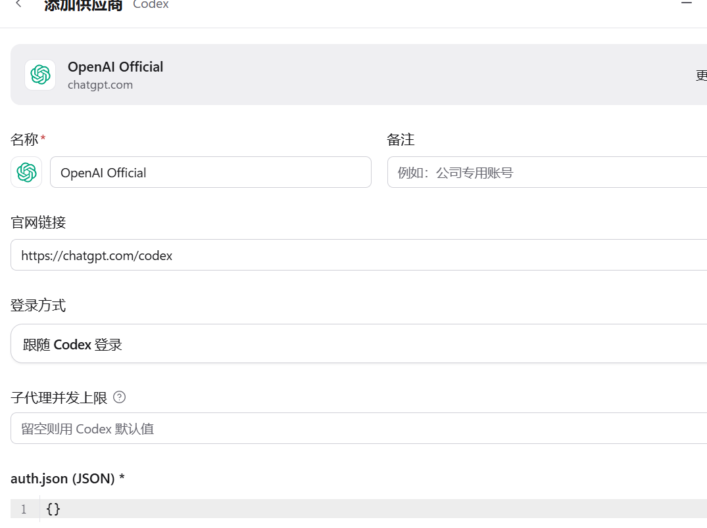
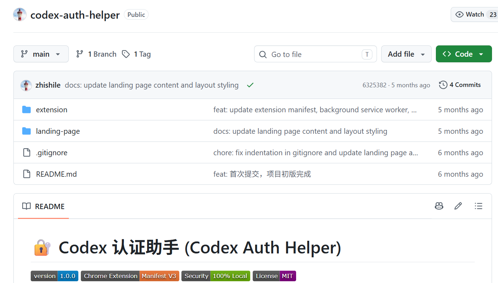
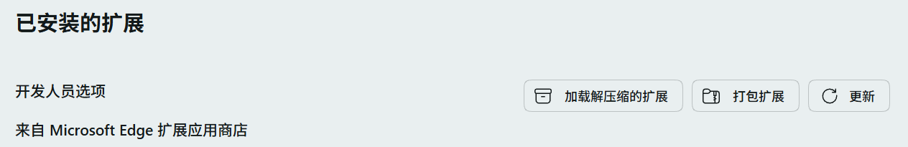
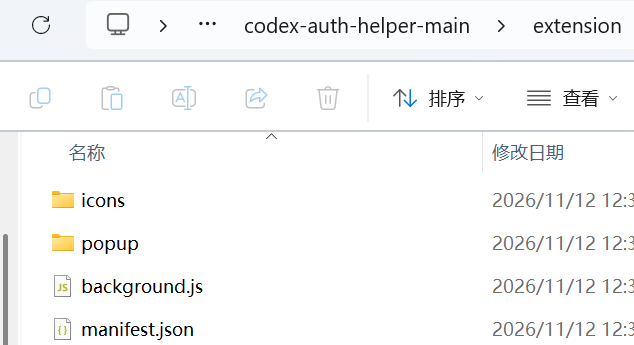
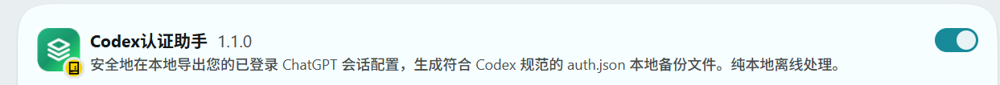
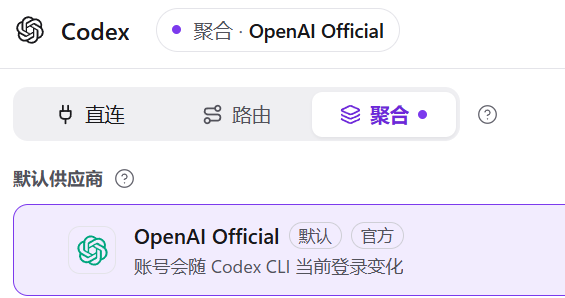

# GPT绑定教程

前提：有安卓的手机，Google账号（可以国内手机号绑定），梯子（建议全程开着）

### 1. 配置电脑端GPT

- 首先当然是去 openAI 官方下载一个 [ChatGPT客户端](https://chatgpt.com/)，同时记得用 Google 账号登录一下网页版，后续要用。

- 下载之后可以直接打开，踩个手机登录的雷😜（⭐第一次打开可能会非常漫长，电脑没有反应，但是任务管理器看得见进程，建议刷会儿抖音）。

- 直接打开之后就会弹登录校验，让输电话号码😫...

- 这个时候就需要 [CC Switch](https://ccswitch.io/zh/download) 登场了。

- 下载好 CC Switch 之后，打开大致如图：

  

- 然后可以先点击右上方的“添加供应商”，选择 **OpenAI official**：

  

- 备注可以随意填（用于区分名字），重要的是 `auth.json`：

  

- `auth.json` 是登录信息，CC Switch 会通过网页登录的信息来欺骗桌面的 Codex（告诉它我已经登录了，从而跳过手机号验证）。

- **如何获取 `auth.json`**：下载一个 GPT 登录信息获取的插件 [Codex Auth Helper](https://github.com/zhishile/codex-auth-helper)，进入网页后如图：

  

- 点击右侧绿色 `Code`，选择 `Download ZIP` 下载到本地，在本地解压缩。然后打开浏览器（这里是用的 Edge，谷歌也类似），进入插件管理页面 [edge://extensions/](edge://extensions/)，打开左下角的“开发人员模式”，在页面最上方点击“加载解压缩的扩展”：

  

- 选择本地刚才解压的路径（⚠️ 注意不是根路径，而是包含这几个文件的路径）：

  

- 上传成功之后就可以使用这个插件了：

  

- 打开刚才登录成功后的 GPT 网页，使用这个插件，然后就可以下载自己的登录信息到本地。
- 然后用记事本或者 VS Code 等等打开这个 JSON 文件，将其中的内容复制粘贴到 CC Switch 的 `auth.json` 中保存即可。
- 切换到聚合模式（要重启一下 CC Switch），然后启动下载好的 GPT 即可😊（如果进行了登录的，记得完全关闭即各种 Codex 进程后重新启动）。

  

### 2. 订阅GPT

总结了当下常用的，列出了几种可能的方法：

- **找人代充**：存在额外手续费，但是方便。⚠️ *风险提示：淘宝/闲鱼代充极容易遇到黑卡，导致 OpenAI 账号被封禁，建议谨慎。*
- **借助苹果设备**：注册一个 Apple ID，然后通过礼品卡或者 App Store 进行订阅。后续可以不再借助苹果设备，可以直接进入苹果的账号管理官网，用 Apple ID 管理之前已经有的订阅，进行续订或者取消（但是不支持重新订阅）。
- **用 Google 账号**：绑定一个万事达银行卡（招商的可以线上预制和预约，然后线下去取，可能需要准备一点余额用于存入卡中），然后用 Google Play 进行订阅：googleplay不用手机开开发者模式，首先设置中搜索谷歌基础服务（开启即可），然后去应用商店（手机自带的就行）下载Googleplay

**打广告**：

朋友做的一个类似电脑便签的程序:[便签小程序](https://github.com/yyunx/wantodo)

金铲铲是一个非常好玩的游戏：[金铲铲之战](https://jcc.qq.com/#/index)

本周日早上3点：BLG vs GEN 

